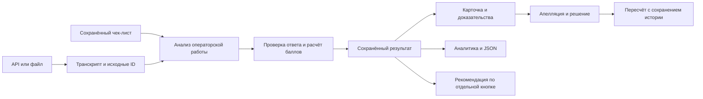

# QULAQ-AI

**От разговора с клиентом — к понятной оценке качества и конкретному следующему действию.**

QULAQ — веб-приложение для анализа работы операторов по готовым транскриптам на русском, казахском и английском языках. Оно оценивает разговор по настраиваемому чек-листу, объясняет каждый ответ и связывает его с репликами. Пользователь может оспорить оценку, проверяющий — пересмотреть её, а руководитель — увидеть общую картину качества.

Проект команды **Amazing Guys**, подготовленный для CQA-хакатона Freedom Broker.

> **Статус: MVP.** В одном интерфейсе можно переключаться между тремя ролями и пройти их рабочие сценарии. Отдельные аккаунты и авторизация пока не реализованы: переключатель показывает функции ролей, а не разграничивает права доступа. Данные сохраняются в локальном рабочем пространстве сервера.

## Навигация

- [Возможности продукта](#features)
- [Три роли и сценарии работы](#roles)
- [Как работает решение](#solution)
- [Критерии и расчёт баллов](#criteria)
- [Данные, результаты и экспорт](#results)
- [Модель и стоимость](#model-cost)
- [Локальный запуск](#quickstart)
- [Команда](#team)
- [Документация и проверки](#docs)
- [Границы MVP](#scope)

<a id="features"></a>
## Возможности продукта

- **Разговор и доказательства рядом.** Баллы, причины и исходные реплики доступны в одной карточке; по ссылке можно перейти к нужному фрагменту.
- **Настраиваемые правила.** Добавляйте и удаляйте критерии, меняйте формулировки, веса, шкалы и условия N/A через интерфейс.
- **Оценка с историей.** Каждый анализ сохраняет использованную версию чек-листа. Изменение настроек не переписывает прежние результаты.
- **Пересмотр человеком.** Апелляция связывает спорный критерий, комментарий пользователя, доказательства и решение проверяющего.
- **Рекомендации оператору.** Отдельный запрос формирует общий пример более удачного подхода к разговору. Подсказки по конкретным нарушениям также показываются, если они присутствуют в ответе модели.
- **Аналитика руководителя.** Периоды, языки, средние баллы, динамика, повторяющиеся нарушения, причины обращений и исходы.
- **JSON-экспорт.** Подробный результат отдельного диалога и официальный файл всего набора для организаторов.

<a id="roles"></a>
## Три роли и сценарии работы

### Пользователь — специалист по качеству

В интерфейсе эта роль обозначена как «Специалист по качеству»: загрузить разговор, разобраться в оценке и при необходимости оспорить её.

1. **Загрузить разговоры.** В разделе «Диалоги» импортировать набор по ссылке API или открыть TXT, JSON либо PDF с текстовым слоем. Для TXT/PDF нужны обозначенные роли говорящих. Импорт сам по себе не запускает оценку.
2. **Выбрать правила.** Использовать стандартный чек-лист или настроить свой в разделе «Чек-листы». Сначала сохранить изменения: анализ использует последнюю сохранённую версию выбранного чек-листа.
3. **Запустить анализ.** Открыть диалог и нажать «Оценить». Сервис анализирует готовый транскрипт; реплики клиента, бота и системные события служат контекстом для оценки оператора.
4. **Посмотреть результат.** В карточке доступны итог, ответы по критериям, веса, объяснения, N/A и доказательства. Для звонка предусмотрены плеер или ссылка на запись.
5. **Получить рекомендацию.** Кнопка «Показать пример» в блоке правильного подхода запускает отдельный запрос. Сохранённые оценки при этом не меняются.
6. **Оспорить или экспортировать.** Выбрать спорный критерий, написать комментарий и отправить апелляцию либо скачать подробный JSON этого диалога. Официальная выгрузка всего набора доступна на странице диалогов.

После пересмотра в карточке остаются исходная оценка, решение проверяющего и актуальный итог.

### Проверяющий — принять обоснованное решение

1. Переключиться в роль «Проверяющий» и открыть очередь апелляций.
2. Выбрать обращение: изучить комментарий, спорную оценку, правило и фрагмент разговора.
3. Подтвердить исходный ответ или выбрать другое допустимое значение, обязательно указав причину.
4. Сохранить решение. Сервис пересчитает итог по правилам именно этого анализа и сохранит историю пересмотра.

Для решения апелляции не нужен повторный запрос к модели. Изменение человеком оценки не означает автоматического обучения модели.

### Руководитель — увидеть повторяющиеся проблемы

1. Переключиться в роль «Руководитель» и выбрать период и язык.
2. Посмотреть количество оценённых разговоров, средний балл и динамику качества.
3. Найти повторяющиеся нарушения, открыть связанные разговоры и проверить доказательства.
4. Изучить причины обращений и исходы: какие вопросы встречаются чаще и какие остаются нерешёнными.

Для каждого разговора отчёт использует последний анализ внутри выбранного периода с учётом пересмотра. Нарушения разделяются по версии чек-листа; средние баллы разных наборов правил следует сравнивать с учётом различий в критериях.

<a id="solution"></a>
## Как работает решение



**1. Подготовка данных.** Backend получает набор, проверяет структуру и сохраняет исходные ID, роли, тексты и метки времени. PDF с текстовым слоем и TXT проходят предпросмотр перед импортом. Исходные данные и сохранённые оценки связаны внутри рабочего пространства.

**2. Оценка.** Модель `kimi-k3` вызывается через API Telecom KZ. Для стандартного чек-листа используется закреплённый промпт; для изменённых критериев инструкции собираются из сохранённых правил. На время запроса фиксируется снимок чек-листа.

**3. Проверка и расчёт.** Модель выбирает ответы по критериям и указывает причины и ссылки на реплики. Backend проверяет состав критериев, допустимые значения, N/A и существование доказательств. Итоговые баллы рассчитываются кодом. Ошибка обработки показывается как ошибка, а не как нулевая оценка оператора.

**4. Сохранение и применение.** Результат хранится вместе с правилами, доказательствами и происхождением оценки. Карточка, аналитика и экспорт читают сохранённые данные. Просмотр и экспорт не запускают модель.

**5. Рекомендации и дополнительные категории.** Общий пример правильного подхода генерируется отдельным ручным запросом по разговору и сохранённой оценке. Классификация причин обращений — отдельная функция; опционально можно подключить локальную Laya. Она не заменяет оценку качества и требует отдельной установки.

### Основные компоненты

| Компонент | Назначение |
|---|---|
| React, TypeScript, Vite | Интерфейс, карточки, редактор правил и отчёты |
| Node.js, TypeScript | API, управление анализом, валидация, апелляции и экспорт |
| Kimi через внешний API | Оценки, объяснения и рекомендации |
| Локальное JSON-хранилище | Диалоги, версии правил, результаты и апелляции |
| Laya, опционально | Локальная классификация причины обращения |

Интерфейс и API разделены клиентским адаптером. Статическая сборка и hash-маршруты предусматривают дальнейшую адаптацию к HTML-компоненту Dynamics 365; готовая интеграция с конкретной средой Dynamics в MVP не заявляется.

<a id="criteria"></a>
## Критерии и расчёт баллов

Начальная конфигурация соответствует чек-листу организаторов:

| Критерий | Ответ | Вес |
|---|---|---:|
| Установление контакта | Да / Нет | 10 |
| Выявление потребности | Да / Нет / N/A | 15 |
| Идентификация | Да / Нет / N/A | 20 |
| Корректность и полнота консультации | 0 / 5 / 10 / 15 / 20 / N/A | 20 |
| Эмпатия и клиентоориентированность | Да / Нет | 15 |
| Ясность и последовательность диалога | 0 / 4 / 7 / 10 | 15 |
| Завершение | Да / Нет / N/A | 5 |
| Грубые ошибки | Да / Нет | Отдельный флаг |

```text
Итог = 100 × сумма(вес × доля выполнения) / сумма применимых весов
```

Для «Да» доля равна 1, для «Нет» — 0. Для числовой шкалы это отношение ответа к максимальной ступени. Например, 7 из 10 при весе 15 даёт 10,5 балла до перераспределения N/A.

N/A означает неприменимость по условию критерия и исключается из расчёта весов. Итог округляется до двух знаков; при отсутствии применимых весовых критериев не рассчитывается. Грубое нарушение отмечается отдельно и автоматически не обнуляет итог. Скорость первой реакции в стандартном критерии ведения диалога не оценивается.

В пользовательском чек-листе можно изменить правила и веса. Каждая новая оценка применяет сохранённую конфигурацию; старые анализы, апелляции и рекомендации остаются связаны со своими снимками правил.

<a id="results"></a>
## Данные, результаты и экспорт

### Наборы организаторов

| Набор | Состав | Статус результатов |
|---|---|---|
| **DEV** — разработка и проверка | 65 диалогов: 60 чатов и 5 звонков; 35 RU, 15 KZ, 15 EN | [Готовый results.json](results/dev/results.json) |
| **Контрольный набор** | 10 чатов, выдаваемых организаторами отдельно | Будет обработан после получения; файл `results/prod/results.json` пока не создан |

DEV используется для разработки и оценки поведения системы. Наличие этого набора не означает, что команда обучала или дообучала на нём веса Kimi.

Опубликованный DEV-файл содержит **65 результатов и 520 оценок критериев** для команды Amazing Guys. Это новый полный прогон `final65_c6c7_two_stage_v1` с сохранёнными исправлениями C6 и C7: 65 успешных вызовов, без повторов. Значения и объяснения при конвертации не переписывались. Точное совпадение с той же рабочей разметкой — **479/520 — 92,12%**, ранее было 481/520 — 92,50%. Все шесть прежних объяснений C6 про три минуты исправлены; их баллы сохранены. Целевая ошибка C7 исправлена, но на всём наборе точное совпадение C7 снизилось с 53/65 до 49/65. Это результат DEV, не контрольного набора и не гарантия правильности каждого объяснения. [Полное сравнение](docs/FINAL_C6_C7_RESULTS.md).

- [Результаты DEV для организаторов](results/dev/results.json)
- [Происхождение и проверка файла](results/README.md)
- [Подробный отчёт по качеству оценок](docs/MODEL_EVALUATION_RESULTS.md)
- [Форматы экспорта](docs/RESULT_JSON_FORMAT.md)

### Два JSON-экспорта

**Официальный JSON набора** соответствует приложению организаторов JSON 1.0. Он содержит название команды, имя модели, все диалоги набора, восемь официальных кодов критериев, ответы, объяснения, номера реплик и итоги. Неудачная обработка тоже включается отдельной записью. Формирование файла использует сохранённые данные и не вызывает модель.

Файлы сдачи располагаются по путям:

```text
results/
├── dev/
│   └── results.json
└── prod/
    └── results.json    # после получения контрольных результатов
```

Для официальной сдачи нужен стандартный набор из восьми критериев. Экспорт проверяет полноту данных и совместимость правил: произвольный пользовательский критерий не подменяет официальный код.

**Подробный JSON диалога** доступен в карточке результата и содержит снимок чек-листа, исходные и пересмотренные ответы, доказательства, транскрипт и сохранённые рекомендации. Это формат приложения для разбора одного разговора, а не замена официальному файлу набора.

<a id="model-cost"></a>
## Модель и стоимость

Для базовой оценки используется `kimi-k3` через Telecom KZ: один запрос оценивает все критерии, возвращает объяснения и доказательства. **Ориентир расходов только на модель — около $0,08–0,10 за диалог**; это средние оценки для двух сохранённых экспериментальных конфигураций, а не фиксированная цена каждого запроса или замер окончательного промпта.

Расчёт использует [публичный тариф Kimi K3](https://www.kimi.com/resources/kimi-k3-pricing), проверенный 8 ноября 2026 года: $3 за миллион входных токенов без кэша и $15 за миллион выходных. Это сравнительная оценка по прямому API Kimi, не подтверждённый тариф или списание Telecom KZ. Скидка за кэш и налоги в расчёт не включены.

| Основание | Средний вход | Средний выход, включая рассуждения | Стоимость базового вызова |
|---|---:|---:|---:|
| Исторический v4: 61 успешный ответ с сохранённым `usage` | 7 683 токена | 3 968 токенов | ≈ $0,083 |
| Полный кандидат на 65 диалогах: оценка по длинам текста, откалиброванная на историческом `usage` | 9 122 токена | 4 717 токенов | ≈ $0,098 |

```text
Цена = (входные токены × 3 + выходные токены × 15) / 1 000 000 долларов
```

Токены рассуждений уже входят в выход и не прибавляются повторно. У четырёх неуспешных запросов исторического v4 нет сохранённого `usage`; их возможные расходы не включены в среднее по успешным ответам. Длина разговора, промпт и объём ответа меняют стоимость.

Общий пример улучшенного разговора — необязательный дополнительный вызов Kimi по отдельной кнопке; его цена добавляется по тому же тарифу и не измерена в приведённых средних. Сервер, хранение и запуск опциональной локальной Laya исключены из этого расчёта. Это оценка расходов на базовый вызов модели, а не полной себестоимости сервиса.

<a id="quickstart"></a>
## Локальный запуск

Нужны **Node.js 24+**, npm и Git. Для реального анализа требуется доступ к API модели.

```sh
git clone https://github.com/aibarC/QULAQ-AI.git
cd QULAQ-AI
npm run setup
cp .env.example .env
```

В `.env` укажите серверные настройки:

```dotenv
LLM_BASE_URL=https://llm.telecom.kz/v1
LLM_API_TOKEN=ваш_токен
```

Затем запустите приложение:

```sh
npm run dev
```

- Интерфейс: **http://127.0.0.1:5173**
- Локальный API: **http://127.0.0.1:8000/api/workspace**

Открытие сайта и импорт не запускают модель. Запрос выполняется при ручном анализе или генерации рекомендаций. Без токена можно открыть интерфейс; реальные модельные действия требуют корректной настройки сервера. Данные сохраняются в `.local/server/workspace.json` и восстанавливаются после перезапуска.

Для работы без внешнего оценщика backend поддерживает `--disable-llm`. Параметры запуска и локальная Laya описаны в [backend/README.md](backend/README.md) и [backend/laya/README.md](backend/laya/README.md).

Исходные приватные наборы, аудиозаписи, токены и локальное рабочее пространство не поставляются с репозиторием. Файл результатов DEV доступен отдельно и не загружается автоматически как история в новом интерфейсе.

<a id="team"></a>
## Команда

**Amazing Guys**

| Участник | Зона ответственности |
|---|---|
| [aibarC](https://github.com/aibarC) | Backend, работа с моделью, правила оценки, расчёт баллов, хранение и интеграция |
| [bagdaulet-dev](https://github.com/bagdaulet-dev) | Frontend, интерфейс, пользовательские сценарии и клиентский адаптер |

В репозитории за этими двумя участниками закреплены основные направления разработки. Изменения готовятся в отдельных ветках `codex/` и передаются через PR; история опубликованных веток не переписывается. Правила работы агентов — в [AGENTS.md](AGENTS.md).

<a id="docs"></a>
## Документация и проверки

- [API, хранение и запуск backend](backend/README.md)
- [Версии и хеши рабочих промптов](llm/prompts/two_stage_v1/manifest.json)
- [Официальный и подробный JSON](docs/RESULT_JSON_FORMAT.md)
- [Результаты DEV и офлайн-конвертация](results/README.md)
- Для будущей адаптации под Dynamics 365 сборка использует относительные пути. Готовой интеграции нет: потребуется размещение ресурсов, настройка доступа к API, контекста CRM и разрешений встраивания.
- [Опциональная локальная Laya](backend/laya/README.md)
- [Правила работы с проектом](AGENTS.md)

```sh
npm test
npm run check
cd frontend
npx playwright test --config=playwright.backend.config.ts
```

Модульные, HTTP- и браузерные тесты проверяют расчёт, сохранение, апелляции, версии чек-листа, импорт и экспорт на синтетических данных. Они не обращаются к реальной модели. Для Playwright нужен браузер; путь можно задать переменной `PLAYWRIGHT_CHROMIUM_EXECUTABLE`.

<a id="scope"></a>
## Границы MVP

- Роли демонстрируют рабочие сценарии в общем пространстве; отдельных учётных записей и промышленного разграничения доступа нет.
- Оцениваются готовые транскрипты. Распознавание речи и OCR сканов не подключены.
- Качество причин и рекомендаций зависит от модели; проверка структуры ответа не доказывает его смысловую правильность.
- Плеер зависит от доступности источника аудио; точное выравнивание временных меток с записью требует проверки.
- Локальное хранилище автоматически не синхронизируется между компьютерами. Production-развёртывание потребует отдельной работы над доступом, хранением и эксплуатацией.
- `kimi-k3` — подтверждённое имя модели в запросах и ответах шлюза. Архитектуру и число её параметров проект не устанавливает. Расчётный ориентир расходов и его ограничения приведены в разделе [«Модель и стоимость»](#model-cost).
